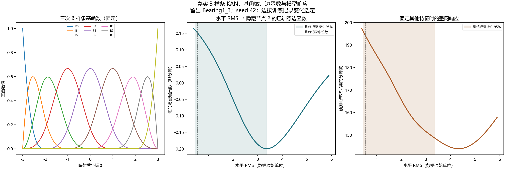
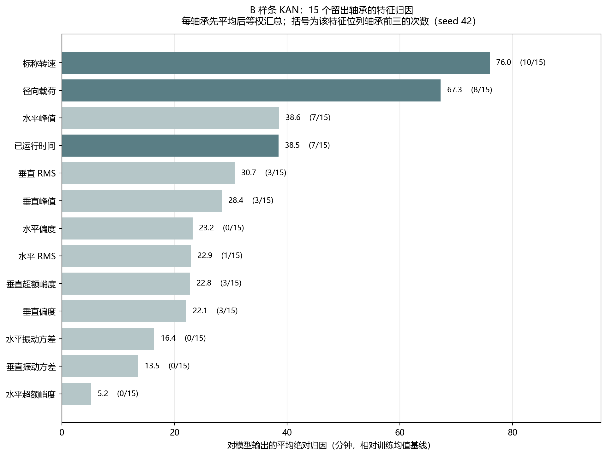

# Bearing-ChebyshevKAN

基于滚动轴承振动数据的故障诊断、剩余寿命（RUL）预测与可解释性实验。项目参考稿件 *Interpretable Bearing Fault Diagnosis via Physics-Aware Chebyshev Kolmogorov-Arnold Networks with Symbolic Equation Discovery*（TIMC-26-1736），并在此基础上增加按轴承划分的分钟级寿命预测和 B 样条 KAN 分析。

本仓库是研究和复现工作记录，**不应直接用于维护决策**。项目中的数据划分、预处理和部分实验与稿件不同；报告实际结果，并保留未达到预期的结果。仓库包含本次实验所用的 CWRU 原始数据及其来源与校验清单；论文审稿稿件和逐字转写的补充材料不随仓库发布。

## 项目内容

- `cwru/`：CWRU 数据上的故障分类、噪声增强和跨负载实验。
- `pu/`、`pu_mendeley/`：Paderborn 原始数据独立轴承三分类，以及第三方预处理 FFT 数据的探索性八分类。
- `xjtu/`：参考稿件的归一化寿命实验；其目标不是分钟级寿命。
- `rul_study/`：XJTU-SY 全部 15 个轴承的分钟级标签、当前记录特征、留一轴承模型比较、预测与检查点。
- `bspline_study/`：三次 B 样条 KAN、留一轴承实验与函数曲线。
- `interpretability/`：输入归因、边函数和物理频率检查；图表分开标注 B 样条和 Chebyshev 模型。
- `rul_audit/`、`spline_verify/`：分组、预测重载和样条基函数的检查脚本。
- `fa_chebykan/`：故障频率锚定原型、CWRU 仿真迁移实验、可追溯元数据及结果，详见 [实验结果报告](fa_chebykan/results/CWRU_实验结果报告.md)。
- `data/CWRU/`：CWRU 本次使用的 16 个官方来源 MAT 文件及 SHA-256 清单。

仓库保留衍生特征表、实验指标、图像与模型检查点。除所列 CWRU 数据外，其他原始数据需从提供方获取并遵守相应许可。CWRU 页面公开提供下载，但本次未找到明确再分发许可证，请查阅 [来源与核查说明](fa_chebykan/CWRU_元数据核查.md)，并向数据提供方核实使用及再分发条件；检查点是研究输出，运行实验会生成新的结果。

## 核心实验：分钟级 RUL

XJTU-SY 共 15 个轴承、9,216 次采集，分属三个工况。每条 CSV 保存两通道各 32,768 个振动点，采集间隔按 1 分钟处理。[数据提供方说明](https://biaowang.tech/xjtu-sy-bearing-datasets/)

对于某个轴承的第 `i` 条记录、共 `N` 条，输入中的已运行时间定义为 `i-1` 分钟，监督标签定义为 `N-i` 分钟。**标签表示距最后一次采集的时间，是试验终点的代理，不是精确机械失效时刻。** 输入不包含 `N`、未来采集或基于测试轴承完整轨迹计算的归一化统计量。

每次留出一个完整轴承测试，另从每种工况各留一个完整轴承验证，其余 11 个轴承训练。缩放参数只由训练轴承拟合；通过验证集选择模型。15 个测试轴承分别评估，神经模型使用种子 42、43、44；先按轴承计算指标，再按轴承和种子平均。训练集始终包含三种工况，因此这是**已见工况下的跨轴承验证**，不是未见工况测试。

| 模型 | 轴承宏 MAE（分钟） | 轴承宏 RMSE（分钟） |
| --- | ---: | ---: |
| 已运行时间与工况 Ridge | 304.38 | 343.04 |
| 当前振动特征与工况 Ridge | 333.42 | 397.85 |
| MLP | 305.58 | 366.58 |
| Chebyshev-KAN | 287.31 | 347.63 |

这里的宏 RMSE 是逐轴承 RMSE 的算术平均，而非所有记录合并后的 RMSE。Chebyshev-KAN 的宏 MAE 在此次实验中最低，但按种子平均仅在 **6/15 个轴承**上优于 MLP；最后 20% 寿命阶段的平均高估仍为 **157.05 分钟**。这些数字不足以证明统计显著的普遍优势或实际部署可靠性。详细分组、候选模型和逐条预测见 [`rul_study/README.md`](rul_study/README.md)。

## B 样条与模型解释

Chebyshev-KAN 的边函数由切比雪夫多项式构成，**不是** B 样条。另训练的 B 样条 KAN 使用三次 B 样条基，每层输入先经 `z = 3*tanh(x/3)` 映射；因此函数是样条与 `tanh` 的复合，不是原始输入坐标上的纯分段三次多项式。样条模型没有显式稀疏正则。



图中左侧是固定样条基；中间是一个已训练隐藏边，纵轴不是预测寿命；右侧将其他输入固定为训练均值，只展示该模型的条件响应。阴影表示训练记录分位范围，**不是**置信区间；固定均值可能构造未观测过的特征组合。

在固定种子 42、同一套轴承分组下，B 样条 KAN 的 15 轴承宏 MAE 为 **288.28 分钟**；相同种子下 Chebyshev-KAN 为 **282.59 分钟**，MLP 为 **299.93 分钟**。单种子比较不支持普遍优劣结论。



这份积分梯度结果按每个留出轴承先求平均，再对 15 个轴承等权；它衡量相对于训练均值基线的**模型输出归因**，不是寿命损失或因果效应。标称转速、径向载荷、水平振动峰值和已运行时间在本次结果中靠前；但数据中的转速和载荷只以固定组合出现，不能区分二者的独立作用。详见 [`bspline_study/README.md`](bspline_study/README.md) 和 [`interpretability/bspline_feature/README.md`](interpretability/bspline_feature/README.md)。

## 环境

建议使用 Python **3.10–3.12** 和隔离的虚拟环境。从仓库根目录：

```powershell
# Windows PowerShell
py -3.12 -m venv .venv
.\.venv\Scripts\Activate.ps1
python -m pip install --upgrade pip
python -m pip install -r requirements.txt
```

```bash
# macOS / Linux
python3 -m venv .venv
source .venv/bin/activate
python -m pip install --upgrade pip
python -m pip install -r requirements.txt
```

使用其他 Python 版本时，请按本机可用版本选择解释器。若希望使用 GPU，请按 [PyTorch 官方安装说明](https://pytorch.org/get-started/locally/)选择与本机兼容的版本。本项目此前保存的实验使用 CPU；硬件、库版本及随机性可能使结果略有不同。仓库中的 PowerShell 示例适用于 Windows；Paderborn 自动解压脚本还依赖能处理对应 RAR 格式的 `tar`。

无需原始数据即可检查 B 样条基函数：

```bash
python spline_verify/test_basis.py
```

该命令会重新生成 `spline_verify/basis_verification.json`。完整训练及部分解释分析需要相应的数据和检查点；脚本运行可能覆盖其默认输出目录。

## 数据准备与运行

### XJTU-SY 分钟级实验

若使用随仓库提供的衍生特征表，可跳过原始 CSV 提取，直接从项目根目录运行训练：

```bash
python rul_study/run_experiments.py --seeds 42,43,44 --epochs 60 --patience 8 --output rul_study/new_results
```

如需从原始振动数据重新生成特征，请从 [XJTU-SY 官方数据页面](https://biaowang.tech/xjtu-sy-bearing-datasets/)或[发布方仓库](https://github.com/WangBiaoXJTU/xjtu-sy-bearing-datasets)下载并按其说明解压，使其位于 `data/XJTU-SY/XJTU-SY_Bearing_Datasets/`，并保留 `35Hz12kN/Bearing1_1/1.csv` 等条件、轴承和连续编号结构，再执行：

```bash
python rul_study/build_features.py --data data/XJTU-SY/XJTU-SY_Bearing_Datasets
```

提取脚本检查轴承数量、连续编号、列名、记录长度和有限值。缓存仅检查形状和记录数；若原始文件内容或版本变化，请使用新的输出目录或先清理对应缓存，再重建。完整流程及结果文件说明见 [`rul_study/README.md`](rul_study/README.md)。

在已有特征表和固定划分的前提下，重新训练 B 样条模型：

```bash
python bspline_study/train.py --seed 42 --epochs 60 --patience 8 --output bspline_study/new_results
```

### CWRU 故障诊断

下载项目使用的 16 个 CWRU MATLAB 文件：

```bash
python download_cwru.py
```

文件来自 [CWRU Bearing Data Center](https://engineering.case.edu/bearingdatacenter/download-data-file)，默认放在 `data/CWRU/`。运行时设定该位置：

```powershell
# Windows PowerShell
$env:CWRU_DATA_DIR = (Join-Path $PWD 'data\CWRU')
python cwru/exp/eval_cwru_holdout.py --output cwru/exp/outputs/new_clean
python cwru/exp/eval_cwru_holdout.py --augment-noise --output cwru/exp/outputs/new_augmented
```

```bash
# macOS / Linux
export CWRU_DATA_DIR="$PWD/data/CWRU"
python cwru/exp/eval_cwru_holdout.py --output cwru/exp/outputs/new_clean
python cwru/exp/eval_cwru_holdout.py --augment-noise --output cwru/exp/outputs/new_augmented
```

该实验的训练和测试来自同一原始记录的不同时段；结果不能代表新轴承上的泛化。Paderborn 数据及第三方预处理数组的来源、准备和局限见 [`pu/README.md`](pu/README.md) 与 [`pu_mendeley/README.md`](pu_mendeley/README.md)。

## 来源与使用边界

- XJTU-SY：[官方发布仓库与引用要求](https://github.com/WangBiaoXJTU/xjtu-sy-bearing-datasets)。Wang, B.; Lei, Y.; Li, N.; Li, N. “A Hybrid Prognostics Approach for Estimating Remaining Useful Life of Rolling Element Bearings,” *IEEE Transactions on Reliability*, 69(1), 401–412, 2020. [DOI: 10.1109/TR.2018.2882682](https://doi.org/10.1109/TR.2018.2882682)。
- Paderborn：Christian Lessmeier 等，KAt-DataCenter，Chair of Design and Drive Technology, Paderborn University，[Bearing DataCenter](https://mb.uni-paderborn.de/en/kat/research/bearing-datacenter)。原始数据使用 [CC BY-NC 4.0](https://creativecommons.org/licenses/by-nc/4.0/)；本仓库的 `interpretability/pu/ig_test.npz` 包含由该数据计算的标准化 FFT 等衍生数组。使用数据请遵守该许可，商业用途请联系提供方。参考论文：Lessmeier, C.; Kimotho, J. K.; Zimmer, D.; Sextro, W., “Condition Monitoring of Bearing Damage in Electromechanical Drive Systems Using Motor Current Signals: A Benchmark Data Set for Data-Driven Classification,” *European Conference of the Prognostics and Health Management Society*, 2016。
- CWRU：[Bearing Data Center](https://engineering.case.edu/bearingdatacenter/download-data-file)。
- KAN 结构参考：[KAN 论文](https://arxiv.org/abs/2404.19756)；B 样条实现验证参考 [SciPy 文档](https://docs.scipy.org/doc/scipy/reference/generated/scipy.interpolate.BSpline.html)。

本仓库未指定开源许可证；请勿将公开访问理解为已授予任意再使用权。原始数据及引用论文分别受其提供方条款约束。
